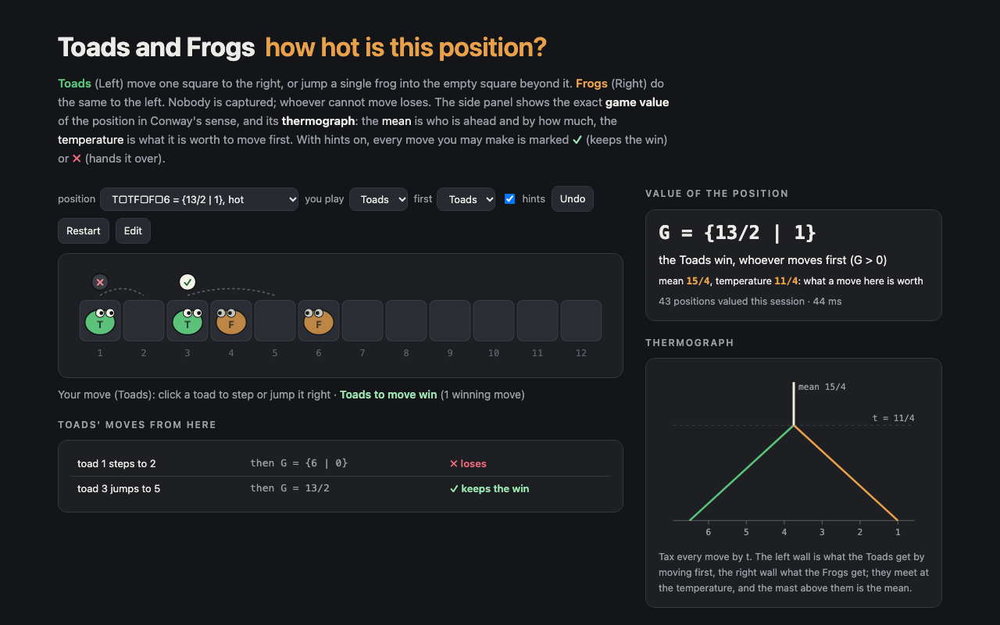

# Toads and Frogs — how hot is this position?



**Toads and Frogs** in the browser, with an exact combinatorial-game-theory engine behind it. The board is a 1×n
strip. **Toads** (Left) move one square to the right, or jump a single frog into the empty square beyond it;
**Frogs** (Right) do the same to the left. Nothing is captured, and whoever cannot move loses.

For every position the page shows the **game value** in Conway's sense (±1/8, {13/2 | 1}, 95/16, or a long
infinitesimal), its **thermograph** with the **mean** (who is ahead, and by how much) and the **temperature** (what a
move there is worth), and the independent pieces the position splits into. With hints on, every move you may make
is marked ✓ (keeps the win) or ✗ (hands it over), the value after each move is listed, and a perfect computer plays
the other side. Edit mode takes any strip of up to 24 squares, typed as `T3□2F3` or clicked in.

TypeScript, no runtime dependencies. The engine runs in a Web Worker on the page and under Node for the checks below.

## The engine

[`src/cgt.ts`](src/cgt.ts) — short games in **canonical form**, interned once each (shared with
[hackenbush](https://github.com/sen-ltd/hackenbush)): dominated options deleted, reversible options bypassed, so
equal games have equal ids; Conway's `le`, sums, negatives, stops and readable names.

[`src/toads.ts`](src/toads.ts) — a board is a string over `T`, `F` and `.`. Before a position is valued from its
options, it is cut down with **Erickson's simplification rules**:

- a run of pieces from a `TT` (or the left edge) to an `FF` (or the right edge) is **dead** and splits the strip
  into two independent games;
- a **terminal toad** (no frog to its right) is worth exactly the empty squares in front of it:
  X T □<sup>n</sup> = X □<sup>n</sup> + n; symmetrically for a **finished frog**;
- by the **Death Leap Principle**, a position containing none of `TF□□`, `□□TF`, `T□`, `□F` is 0.

What is left is a sum of pieces plus an integer; each piece is valued from its options and memoised by its string.
`RawValuer` values the same game straight from the definition, and `Minimax` is a win/lose search that knows
nothing about values; both exist only to check the fast path.

[`src/thermo.ts`](src/thermo.ts) — **thermographs** as piecewise-linear walls in the tax t ≥ 0. The left scaffold is
the max over Left options of their right walls minus t, the right scaffold the min over Right options of their
left walls plus t; they meet at the temperature, and above it both walls are the mast at the mean. Every breakpoint
is dyadic, so doubles stay exact.

[`src/notation.ts`](src/notation.ts) parses the papers' notation (`{{3*|5/2}|2}`, `±({1|*}, …)`, `1/2v`) into
canonical games, so published values are compared by id, not by string.

## Checks

All runs are in [`runs/`](runs), produced by [`tools/verify.mts`](tools/verify.mts) and summarised by
[`tools/report.mts`](tools/report.mts). Node 26, Mac mini, several processes at a time, so times are rough.

**Every strip up to 12 squares** (797,160 boards, 29 s): the value with the simplification rules equals the value
straight from the definition, the mirror image (reversed, toads ↔ frogs) is the negative, and the outcome read off
the value (G > 0, G < 0, G = 0, G ‖ 0) equals a plain win/lose search with each side moving first. **0 mismatches.**

| squares | boards | distinct values | numbers | infinitesimals | hot (t > 0) | hottest | its value | temperature |
|---|---|---|---|---|---|---|---|---|
| 4 | 81 | 14 | 77 | 2 | 2 | T2□F | {1/2 \| 0} | 1/4 |
| 6 | 729 | 54 | 633 | 36 | 34 | T4□F | {{2 \| 1} \| 0} | 3/4 |
| 8 | 6,561 | 280 | 5,224 | 335 | 532 | T5□TF | {4 \| 1} | 3/2 |
| 9 | 19,683 | 676 | 14,925 | 995 | 1,919 | T3□T□TF2 | {6 \| {2\* \| 1\*}} | 9/4 |
| 10 | 59,049 | 1,613 | 42,770 | 2,829 | 6,894 | T4□T□TF2 | {8 \| {3\* \| 1\*}} | 3 |
| 11 | 177,147 | 4,272 | 122,781 | 7,813 | 24,395 | T4□2T□TF2 | {12 \| {{6\* \| 9/2} \| 4}} | 15/4 |
| 12 | 531,441 | 11,107 | 352,717 | 21,560 | 84,662 | T5□2T□TF2 | {15 \| {{8\* \| 11/2} \| 5}} | 19/4 |

**The literature** (`literature`, 104 s): **1,733 checks, 1,732 agree.** Every published value of Erickson,
*New Toads and Frogs Results* (1996) — the T<sup>a</sup>□<sup>b</sup>F<sup>a</sup> table including the full
canonical form of T4□□F4, the T<sup>a</sup>□<sup>b</sup>F<sup>c</sup> table for c ≤ 4, and the "(7\*|9/2‖4)-ish"
T7□4F3 by its mean and temperature — and every value of Thanatipanonda, *Further Hopping with Toads and Frogs*
(2008), within 14–15 squares; Erickson's lemmas 4.1–4.4 on knots, theorems 3.1, 3.3, 3.5, 5.2, 7.7, corollary 3.2,
lemma 6.3, his conjectures 7.1–7.5 and Thanatipanonda's theorems and conjectures 1, 3, 4 on the boards in reach.

- **The one that does not agree is a disagreement between the papers.** Thanatipanonda's table of
  T<sup>a+2</sup>□<sup>b</sup>F<sup>a</sup> gives T5□4F3 = {{5/2 | 2} | 2}; Erickson's table gives {{3\* | 5/2} | 2},
  and so does the engine. To settle it without trusting the engine's comparisons, `literature` plays the sum
  T5□4F3 − X by plain search for both candidates X (X only through its option lists): the second player wins
  T5□4F3 − {{3\* | 5/2} | 2} whoever starts, and does not win T5□4F3 − {{5/2 | 2} | 2}.
- **Erickson's theorem 3.5 is printed as "T□TF□F□<sup>n</sup> = {a + ½ | 1}" with an *a* that is never defined.**
  The values are {n + ½ | 1} for every n ≥ 6 checked (6–16), temperature (2n − 1)/4, which is the "arbitrarily
  high multiples of ¼" the paper is after.
- Conjecture 7.4 (T<sup>a</sup>□<sup>a</sup>F<sup>a−1</sup> = 1 or 1\*) holds for a ≤ 6: 1, 1, 1\*, 1\*, 1, 1.
  Thanatipanonda reports it fails at a = 7 (T7□7F6 > 2); that board is out of reach here.

**Extending the tables** (`symmetric`, `family`): [below](#tables). The `family` runs value
T<sup>a+k</sup>□<sup>b</sup>F<sup>a</sup> (k = 1, 2, 3) up to 18 squares and were stopped partway (each JSON lists
the cells it reached: 53, 41 and 34 cells, 91 of them published, 1 disagreement — the same T5□4F3). Cells the paper
gives only as inequalities now have exact values:

| board | published | exact |
|---|---|---|
| T4□9F3 | < 11/2 | 43/8 |
| T4□10F3 | < 6 | 23/4 |
| T5□7F4 | 5/2 < V < 3 | 43/16 |
| T5□8F4 | < 4 | 29/8 |
| T6□5F5 | 5/4 < V < 2 | 2 + 4·↓ |
| T6□6F3 | ‖ 8 | {8, 8↓\* \| {15/2 \| 7}} |
| T7□6F4 | ‖ 5 | a 62-character form, mean 23/4, temperature 3/4 |

**Thermographs** (`thermo 20000 12`): 20,000 random pairs of boards up to 12 squares, half of them drawn among hot
boards only. mean(G + H) = mean(G) + mean(H) for all of them, temperature(G + H) ≤ max of the two for all of them,
and the two boards joined by a dead `TTFF` wall have the value G + H. Textbook thermographs (±1, {3 | 1}, ±1/8,
{1 | {1/2 | 0}}, ↑, \*, …) worked by hand match.

<a id="tables"></a>

### T<sup>a</sup> □<sup>b</sup> F<sup>a</sup> (`symmetric`)

One cell at a time, a fresh table of positions per cell. Every published cell in reach agrees.

| a | b | values for b = 1, 2, 3, … | b with G ≠ 0 | published cells checked |
|---|---|---|---|---|
| 2 | 1–70 | \* \* \* \* 0 0 \* 0 0 0 0 0 \* … | 1, 2, 3, 4, 7, 13, 19, 25, …, 61, 67 (all \*) | 20 / 20 |
| 3 | 1–29 | \* ±1/8 0 \* 0 \* 0 0 0 0 0 0 0 \* 0 … | 1, 2, 4, 6, 14, 29 | 20 / 20 |
| 4 | 1–13 | \* (T4□□F4, 88 characters) \* 0 0 0 0 \* \* 0 0 0 0 | 1, 2, 3, 8, 9 | 13 / 13 |
| 5 | 1–6 | \* (T5□□F5, 270 characters) \* \* \* 0 | 1–5 | 6 / 6 |

- T2□<sup>b</sup>F2 is \* exactly at b = 7 + 6n from b = 7 on, and 0 otherwise, up to b = 70: Thanatipanonda's
  conjecture 2 and his note on 21 ≤ b ≤ 103. The b = 70 cell took 63 s and 2,427,983 piece positions.
- T3□<sup>b</sup>F3 is 0 for every b from 15 to 28 and \* at b = 29: the single exception Thanatipanonda notes
  for 21 ≤ b ≤ 53. The b = 29 cell took 285 s and 11,532,528 piece positions; the run was stopped there.
- T4□13F4 took 172 s and 5,659,906 piece positions; the rows grow fast because a piece position is keyed by
  its whole string.

## Tests

`npm test` (vitest, 16 tests): moves and jumps, the notation round trip, the Winning Ways classics (T□F = \*,
TT□FF = \*, TTT□□FFF = ±1/8), Erickson's simplification example collapsing to 1 with no search, simplified =
raw value and value outcome = win/lose search on every strip up to 8, mirror = negative, the Death Leap
Principle, the one-frog closed form, T4□□F4 exactly as printed, the disputed T5□4F3, textbook thermographs,
theorem 3.5 with its temperature, means adding over 300 random sums, a number plus 4·↓ printed unambiguously, and parsing back every printed name.

## Run it

```sh
npm install
npm run dev                               # the page
npm test
node tools/verify.mts boards 12           # → runs/boards-12.json
node tools/verify.mts literature
node tools/verify.mts symmetric 2 70      # T2 □^b F2, b = 1..70
node tools/verify.mts family 1 8 16 18    # T^(a+1) □^b F^a up to 18 squares
node tools/verify.mts thermo 20000 12
node tools/report.mts                     # the tables above
```

## References

- J. Erickson, *New Toads and Frogs Results*, in R. J. Nowakowski (ed.), Games of No Chance, MSRI Publications 29,
  Cambridge University Press, 1996, pp. 299–310.
- T. Thanatipanonda, *Further Hopping with Toads and Frogs*, arXiv:0804.0640, 2008.
- E. R. Berlekamp, J. H. Conway, R. K. Guy, *Winning Ways for your Mathematical Plays*, 2nd ed., vol. 1, A K Peters,
  2001 (Toads and Frogs, thermographs).
- A. N. Siegel, *Combinatorial Game Theory*, Graduate Studies in Mathematics 146, AMS, 2013 (canonical forms,
  thermographs).

## License

MIT

<!-- sen-publish:links -->
## Links

- 🌐 Demo: https://sen.ltd/portfolio/toads-and-frogs/
- 📝 記事: https://qiita.com/sen-ltd/items/c843a4e683d68ca60c90
<!-- /sen-publish:links -->
